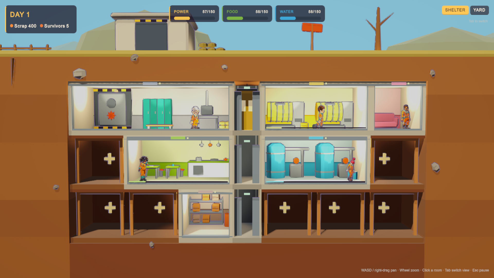

# Z Survival

**Build by day. Survive the night.**

A post-apocalyptic shelter-management and zombie-defense game by [Wolklaw](https://wolklaw.dev).
Run an underground shelter like a vault-management game, then step up to the surface at night and
defend the door like a top-down zombie shooter.

## Download (v0.9.0, free)

| Platform | File |
|---|---|
| Windows 10/11 (64-bit) | [ZSurvival-0.9.0-Windows.zip](../../releases/latest) — unzip and run `ZSurvival.exe` |
| Android | [ZSurvival-0.9.0.apk](../../releases/latest) — sideload (allow "install unknown apps") |

Both are on the [Releases page](../../releases/latest).

| Stat | Value |
|---|---|
| Total downloads |  |
| Latest release downloads |  |
| Latest version |  |
| Stars |  |

**Heads up:** this is an early, unsigned build. Windows SmartScreen may warn on first launch
("More info" → "Run anyway"), and Android will ask you to allow installs from your browser or file manager.

## Press & media

Press kit: [presskit/](presskit/) — [fact sheet](presskit/FACTSHEET.md), [screenshots](presskit/images/),
[credits](presskit/CREDITS.md), and a [one-page overview](presskit/index.html).

## Links

- Developer: [wolklaw.dev](https://wolklaw.dev)
- GitHub: [Wolklaw](https://github.com/Wolklaw)
